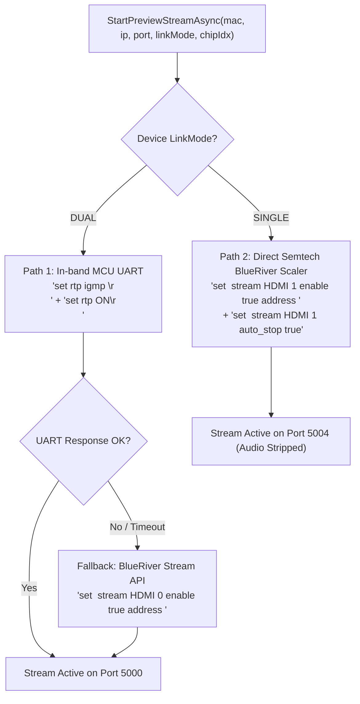

# Technical Specification: v1.8.0 Mode-Aware Preview & Hardware Control Pipeline

## 1. Overview & Context

In AVAS-223 / SDVoE deployments, hardware endpoints operate in one of two distinct topologies:
1. **Dual Link Mode (`LinkMode == "DUAL"`, 10GBY2)**: The primary 10G link (Chip 0 / Major MAC) and secondary 10G link (Chip 1 / Minor MAC) bond to transmit uncompressed 4K60 4:4:4 HDR video (~18 Gbps). The Cypress MCU auxiliary processor is physically hardwired to Chip 0's serial bus.
2. **Single Link Mode (`LinkMode == "SINGLE"`, Autonomous 10G)**: Each AVP2000 chip operates as an independent 10G node. Chip 1 has no physical UART bus to the MCU; video preview must be commanded directly via the Semtech BlueRiver AVP2000 PHY packetizer.

The legacy Dual Link SDVoE Tester only functioned reliably in Dual Link mode because its preview engine exclusively relied on MCU UART in-band tunneling (`send <MAC> rs232:1 set rtp igmp <IP>`). In Single Link mode, or when interacting with Chip 1, this path silently fails.

This specification modernizes the application into a **Mode-Aware Preview & Routing Architecture** based on the reverse-engineered blueprints from `SingleModeSDVoETester` (`SingeLink_REA_Report`) and `Dual Link SDVoE Tester` (`REA_Reports`).

---

## 2. Architectural Decisions & Key Invariants

### 2.1 Mode-Aware Dual-Path Preview Dispatch
The application shall branch its preview stream acquisition based on `LinkMode`:



- **Dual Link Mode**:
  - Target MAC: Chip 0 (`device.MacAddress`).
  - First attempt: MCU UART command `set rtp igmp <multicastIp>\r\n` followed by `set rtp ON\r\n` on port 5000.
  - Automatic fallback: If UART is unacknowledged or fails, fallback to Semtech BlueRiver Stream 0 / Stream 1 API.
- **Single Link Mode**:
  - Target MAC: Active selected chip (`ChipIndex == 0 ? device.MacAddress : device.CompanionMac`).
  - Bypasses MCU UART entirely (avoiding UART serial timeouts).
  - Configures Stream 1 (`HDMI:1` Hardware Scaler node, `remove_audio: true`):
    `set <target_mac> stream HDMI 1 enable true address <multicast_ip>\r\n`
    `set <target_mac> stream HDMI 1 auto_stop true\r\n`
  - Operates on UDP port 5004.

### 2.2 Deterministic Double-Action Teardown
To prevent lingering multicast flood and Winsock port desynchronization:
1. **Control Plane Nullification**:
   - Issue: `set <target_mac> stream HDMI 1 enable false address 0.0.0.0\r\n`
   - Issue: `set <target_mac> stream HDMI 0 enable false address 0.0.0.0\r\n`
   - Issue: `send <target_mac> rs232:1 set rtp OFF\r\n`
   - Issue: `stop <target_mac>:thumbnail:0 free\r\n`
   - Setting address to `0.0.0.0` with `enable false` commands the AVP packetizer FIFO to immediately stop emitting UDP datagrams.
2. **Media Plane Disposal**:
   - Drop IGMP multicast membership on the host NIC.
   - Clean up DemuxChannel packet queues.

### 2.3 Dual-Port Concurrent Ingestion in `UnifiedRtpDemuxReceiver`
- Rather than forcing an operator to reconfigure ports when switching between Dual Link (port 5000) and Single Link (port 5004) devices, `UnifiedRtpDemuxReceiver` shall bind and listen on **both UDP port 5000 and port 5004 concurrently**.
- Both sockets are bound with:
  - `ExclusiveAddressUse = false`
  - `SocketOptionName.ReuseAddress = true`
  - 8MB Receive Buffer (`ReceiveBufferSize = 8 * 1024 * 1024`)
- Incoming datagrams from either port pass through the strict **Source-IP Whitelist Filter** (REA Report 06) before RFC 4175 parsing.
- Multicast group joins are executed across both active UDP sockets.

### 2.4 UI/UX — Single Link Chip 0 / Chip 1 Preview Toggle
- For Dual Link devices: The card displays "Dual Link" badge; preview is anchored to Chip 0 (representing the bonded stream).
- For Single Link devices: When a companion chip is present (`CompanionMac` is valid), the preview card header exposes a sleek chip toggle:
  `[ Chip 0 | Chip 1 ]`
- Default: `Chip 0`.
- Clicking `Chip 1`:
  - Gracefully stops Chip 0 preview stream with `address 0.0.0.0`.
  - Commands Chip 1 (`CompanionMac`) to start streaming Stream 1 Scaler.
  - Updates card status and binds video channel to the incoming Chip 1 stream.

---

## 3. Interface & Contract Specifications

### 3.1 `IMulticastController`
```csharp
public interface IMulticastController
{
    string? AllocateMulticastIp(string macAddress);
    void ReleaseMulticastIp(string macAddress);
    
    // Mode-aware stream control
    Task<bool> StartPreviewStreamAsync(
        string macAddress, 
        string multicastIp, 
        int port, 
        string linkMode = "UNKNOWN", 
        int chipIndex = 0, 
        CancellationToken ct = default);

    Task<bool> StopPreviewStreamAsync(
        string macAddress, 
        string linkMode = "UNKNOWN", 
        int chipIndex = 0, 
        CancellationToken ct = default);

    // Existing hardware maintenance contracts
    Task<bool> FactoryResetAvpAsync(AvasDevice device, string targetMac, CancellationToken ct = default);
    Task<bool> FactoryResetMcuAsync(AvasDevice device, CancellationToken ct = default);
    Task<bool> RebootChipAsync(AvasDevice device, string targetMac, CancellationToken ct = default);
    Task<bool> RebootMcuAsync(AvasDevice device, CancellationToken ct = default);
}
```

### 3.2 `UnifiedRtpDemuxReceiver`
```csharp
public class UnifiedRtpDemuxReceiver : IDisposable
{
    public static readonly int[] DefaultPorts = new[] { 5000, 5004 };
    public IReadOnlyList<int> ListeningPorts { get; }
    public void EnsureStarted(IEnumerable<int>? ports = null);
    ...
}
```

### 3.3 `EncoderCardViewModel`
```csharp
public class EncoderCardViewModel : ViewModelBase
{
    public int SelectedChipIndex { get; set; }
    public bool CanSelectChip1 { get; }
    public string ActiveStreamingMac { get; }
    public ICommand SelectChip0Command { get; }
    public ICommand SelectChip1Command { get; }
    public Func<EncoderCardViewModel, int, Task>? OnChipSelectionChanged { get; set; }
    ...
}
```

---

## 4. Test Verification Plan
- **Unit Tests**:
  - `SdvoeTests`: Verify that calling `StartPreviewStreamAsync` with `linkMode = "SINGLE"` executes `set <MAC> stream HDMI 1 enable true address <mcast>` on port 5004 and `auto_stop: true`.
  - `SdvoeTests`: Verify that calling `StopPreviewStreamAsync` executes `address 0.0.0.0` nullification.
  - `RtpTests`: Verify dual-port binding (5000 and 5004) and packet demuxing from both ports.
  - `EncoderCardViewModelTests`: Verify `CanSelectChip1` logic, toggle commands, and `ActiveStreamingMac` resolution.
- **E2E Tests**:
  - E2E single link stream start/stop and chip toggle lifecycle.
- **Regression**:
  - Full suite pass of all 565 existing tests.
